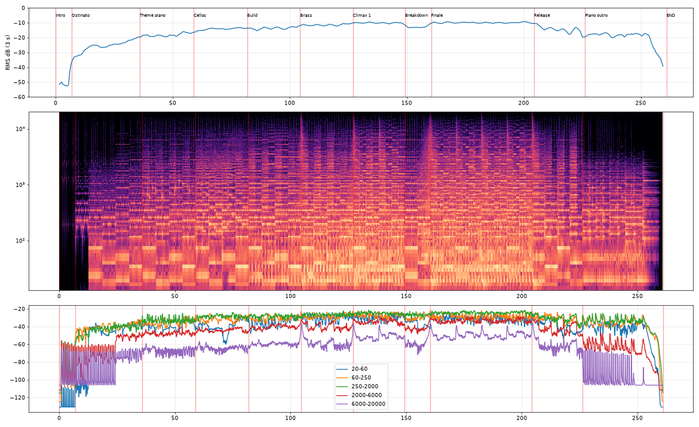

# 🕳️ EREIGNISHORIZONT (V2 – Resurrected)

Ein epischer Soundtrack im Geist von Hans Zimmers *No Time For Caution*, *Time* und *Cornfield Chase*: ein warmes Kirchenorgel-Ostinato, ein Uhrwerk, das nie stillsteht, ein Sub-Bass-Pedal für echten Druck und ein Leitmotiv, das vom Flügel bis zum vollen Blech wächst.
**Alle Themen sind Originalkompositionen.**

▶️ **Anhören:** [`ereignishorizont.mp3`](./ereignishorizont.mp3) (4:21, 320 kbps) oder im Player [`index.html`](./index.html)

## Aufbau

| Zeit | Teil | Was passiert |
|---|---|---|
| 0:00 | **Uhrwerk** | Die Uhr tickt allein. Ein warmes Flöten-Orgel-Ostinato in Achteln setzt ein, darunter ein Sub-Pedal auf D1 (36,7 Hz). Harmonie i–VI–III–VII: d-Moll, B-Dur, F-Dur, C-Dur. |
| 0:35 | **Leitmotiv** | Die Orgel fließt in Sechzehnteln, die Uhr in Achteln. Der Flügel stellt das Leitmotiv vor, dann die Celli. Die Streicher atmen in Zwei-Takt-Schwellern. |
| 1:21 | **Aufbau** | Chor, Geigen-Gegenstimme, Taiko-Herzschlag. Ab 1:44 Hörner und Posaunen im Unisono. |
| 2:06 | **Höhepunkt** | Trompeten, Hörner und Posaunen in Oktaven, Streicher-Tremolo, volle Orgel. Dann der Breakdown: nur Orgel und Uhr. |
| 2:40 | **Finale** | Zweimal das Motiv mit dem ganzen Orchester. Das Tempo steigt über das ganze Stück stetig von 82 auf 88 BPM. |
| 3:46 | **Flügel** | Der Flügel spielt das Leitmotiv intim und warm verhallt, das Tempo gibt nach, die Uhr läuft aus. |

## Was sich gegenüber V1 geändert hat

| Problem in V1 | Lösung in V2 |
|---|---|
| trocken, dünn, „General-MIDI" | Orchester aus der **Aegean Symphonic Orchestra**-Soundfont (Virtual Playing Orchestra) statt SSO/MuseScore GM. Die alten SSO-Celli brauchten 216 ms bis zur halben Lautstärke, die Aegean-Sektionen etwa 50 ms. Dazu der Salamander-Flügel. |
| zu wenig Raum | **Hybrid-Faltungshall**: echte frühe Reflexionen eines aufgenommenen Konzertsaals (EchoThief) plus 4,3-s-Kathedralen-Hallfahne, **32 % wet** |
| mechanisch | **Humanisierung**: Timing-Jitter ±5–15 ms, Velocity folgt der Phrase, CC11-„Atmen" der Streicher, stetige Temposteigerung 82 → 88 BPM |
| „blechernes Gezirpe" | **warme Orgel**: Registrierungen ohne Mixturen, Höhen ab 2,6–3,8 kHz abgerundet, halbiertes Anblasgeräusch, gedoppelt mit einer gesampelten Pfeifenorgel |
| kein Druck | **Sub-Bass**: Sinus plus Reese-Layer auf D1/F1/C1/B♭1 (33–58 Hz) unter dem Orgelpedal |
| flache Dynamik | Orgel-Schichten, Pedal und Sub sind vom Pianissimo bis zum Finale automatisiert. Gemessener Verlauf: −25 → −18 → −14 → −10 → Breakdown −13 → Finale −10 → Flügel −19 dB RMS. |

## Mastering-Kette

Hochpass 30 Hz (4. Ordnung) → +2,5 dB bei 55 Hz → −1,2 dB bei 300 Hz → High-Shelf −2 dB ab 10 kHz, Tiefpass 18 kHz → Glue-Kompressor (1,8:1) → **True-Peak-Limiter** (4× Oversampling, Look-ahead). Der Pegel ist so gewählt, dass der Limiter nie mehr als **3 dB** arbeitet.

**Messwerte:** −13,1 LUFS integriert, True Peak −1,13 dBTP, **0 geclippte Samples** (auch in der dekodierten MP3), keine Transienten außer den gewollten Uhr-Ticks.



## Selbst rendern

```bash
cd source
./render.sh      # lädt Soundfonts (~1 GB) und Impulsantworten, rendert, mischt, mastert -> build/out/
```

*Samples: Virtual Playing Orchestra / Aegean Symphonic Orchestra (Musik damit zu erstellen ist ausdrücklich frei), Sonatina Symphonic Orchestra (CC Sampling+), MuseScore General (MIT). Impulsantworten: [EchoThief](https://www.echothief.com/) (Nutzung für Hall in künstlerischen Werken erlaubt). Die Bibliotheken selbst werden nicht weitergegeben.*
