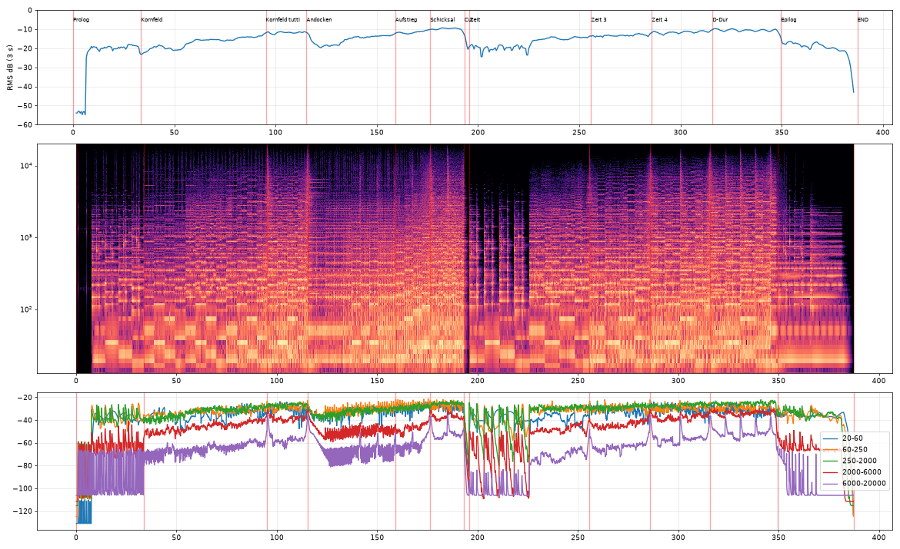

# ✦ HORIZONT – Opus 1

**Ein Epos in einem Satz.** Vom Kornfeld über das Andocken bis zur Zeit selbst: ein durchkomponiertes Werk im Geist von Hans Zimmer (*Cornfield Chase*, *No Time For Caution*, *Time*) und Scott Buckley. Es hat zwei Leitmotive und führt von d-Moll nach D-Dur.
**Alle Themen sind Originalkompositionen.**

▶️ **Anhören:** [`horizont.mp3`](./horizont.mp3) (6:27, 320 kbps) oder im Player [`index.html`](./index.html)

## Die Leitmotive

- **„Hoffnung"**: eine lyrische Linie über d, B, F, C (i–VI–III–VII). Zuerst allein am Flügel, dann in Celli und Hörnern, schließlich im ganzen Orchester in D-Dur. Dafür ändert sich genau ein Ton: F wird Fis.
- **„Schicksal"**: eine düster-heroische Blechfanfare in D-Phrygisch (A–A–A–**D**, C–B–A, B–A–G–F, **Es**–D).

## Aufbau

| Zeit | Teil | Tempo | Was passiert |
|---|---|---|---|
| 0:00 | **I · Prolog** | 72 → 92 | Die Uhr tickt allein. Der Flügel spielt „Hoffnung" über einem Orgel-Hauch. Die Uhr beschleunigt in den nächsten Teil. |
| 0:33 | **II · Kornfeld** | 92 → 96 | Warmes Orgel-Ostinato in Achteln und Sechzehnteln, Sub-Pedal. Die Celli singen, dann Hörner, Chor und Geigen. Tutti ab 1:35. |
| 1:55 | **III · Andocken** | 108 → 116 | Ein Schlag, dann ein unerbittliches Ostinato, Staccato-Streicher, Taikos, die Uhr in Achteln. Ab 2:39 steigen die Stufen d, Es, F, g, A, die Uhr läuft in Sechzehnteln. Ab 2:56 die **Schicksal-Fanfare**. Bei 3:13 der **harte Schnitt** auf der Dominante. |
| 3:15 | **IV · Zeit** | 64 | Ein Zyklus, fünfmal geschichtet: Flügel, dann Celli, dann Hörner mit dem Zeit-Motiv der Geigen, dann das Tutti in Moll. |
| 5:15 | **V · D-Dur** | 64 | Alles wendet sich nach D-Dur, zur Folge I–♭VI–♭III–♭VII. „Hoffnung" in Trompeten, Geigen und Chor, dazu Glocken. |
| 5:49 | **VI · Epilog** | 64 → 50 | Ein letzter Akkord, dann erinnert sich der Flügel. Die Uhr wird langsamer und bleibt stehen. |

## Produktion

- **Orchester**: Aegean Symphonic Orchestra (basiert auf Virtual Playing Orchestra) mit Salamander-Flügel, gerendert über FluidSynth in 41 Stems.
- **Orgel**: additiv synthetisiert, warm registriert ohne Mixturen, phasenkontinuierliche Winddrift, gedoppelt mit einer gesampelten Pfeifenorgel.
- **Staccati** als geformte One-Shots, damit kein Sustain-Sample abgeschnitten wird.
- **Sub-Bass**: Sinus plus Reese auf 33–58 Hz.
- **Humanisierung**: Timing ±5–15 ms, phrasierte Velocity, CC11-Schweller, Tempokurven.
- **Hall**: hybrid aus echtem Konzertsaal (EchoThief-Impulsantwort) plus 4,2-s-Hallfahne, 31 % wet.
- **Mastering**: Hochpass 30 Hz → +2,5 dB bei 55 Hz → −1,2 dB bei 300 Hz → High-Shelf −2 dB ab 10 kHz → Glue-Kompressor → True-Peak-Limiter mit 4× Oversampling (max. 3 dB Gain-Reduktion).

**Messwerte:** −14,5 LUFS, True Peak −1,13 dBTP, **0 geclippte Samples** (auch in der dekodierten MP3), keine Transienten außer den Uhr-Ticks. Die Chroma-Analyse bestätigt die geplanten Harmonien. Dynamik in dB RMS: Prolog −21 → Kornfeld-Tutti −12 → Andocken −15 → Schicksal −10 → Schnitt → Zeit −17 → D-Dur −11 → Epilog −20.



## Selbst rendern

```bash
cd source
./render.sh      # lädt Soundfonts (~1 GB) und Impulsantworten, rendert, mischt, mastert -> build/out/
```

*Samples: Virtual Playing Orchestra / Aegean Symphonic Orchestra (Musik damit zu erstellen ist ausdrücklich frei), Sonatina Symphonic Orchestra (CC Sampling+), MuseScore General (MIT). Impulsantworten: [EchoThief](https://www.echothief.com/). Die Bibliotheken selbst werden nicht weitergegeben.*
