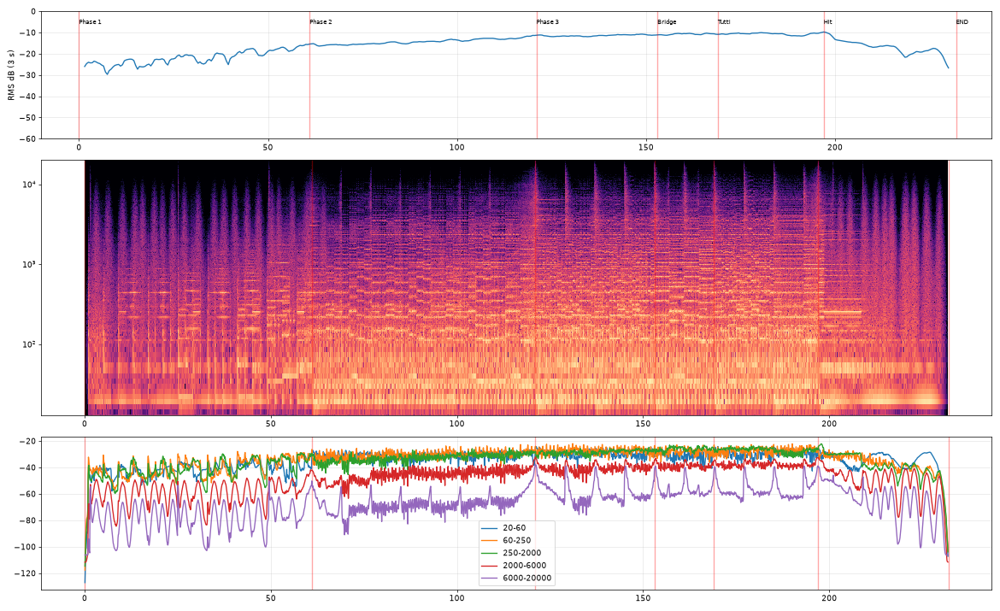

# 🌊 LEVIATHAN (V2 – The Colossus Awakens)

Ein unerbittlicher 12/8-Marsch in D-Phrygisch, im Geist von Holsts *Mars*, Two Steps From Hells *Heart of Courage* und Zimmers *Dune* und *Gladiator*.
Die Regel: **kein Chaos.** Epik entsteht durch Kontrast und Wucht, nicht durch Notenmenge.
**Alle Themen sind Originalkompositionen.**

▶️ **Anhören:** [`leviathan.mp3`](./leviathan.mp3) (3:52, 320 kbps) oder im Player [`index.html`](./index.html)

## Aufbau

| Zeit | Phase | Was passiert |
|---|---|---|
| 0:00 | **Grollen** | Ozean, Kontrabässe, Kontrafagott, Sub-Bass auf D. Schleppende, gewaltige Paukenschläge. Bedrohliche Horn-Schwelltöne in leeren Quinten (D–A, Es–B), ab 0:32 mit Posaunen. Der Männerchor summt. |
| 1:00 | **Ostinato** | Ein erbarmungsloses Staccato-Ostinato (punktierte Viertel = 120) mit dem phrygischen Es als Auftakt. Taikos, schwere Große Trommel auf „1 und 4", Snare-Wirbel, dann Horn- und Posaunen-Schweller. |
| 2:01 | **Fanfare** | Der Leviathan bricht aus. Die Hörner spielen eine heroisch-düstere Fanfare (A–A–A–**D**…), Posaunen im Unisono. Beim zweiten Mal Trompeten, Chor und hohe Streicher obendrauf. Pauken auf jedem Schlag, Becken alle vier Takte. |
| 2:49 | **Tutti** | Die Fanfare mit allem, danach hämmernde D-Akkorde und ein Crescendo. |
| 3:17 | **Schlag** | Ein brachialer Crescendo-Schlag, dann ein tiefes, nachhallendes Sub-Grollen im Ozean. |

## Was sich gegenüber V1 geändert hat

V1 (unveröffentlicht) ist ab 3:27 in Klangbrei zerfallen. Die Ursachen, gefunden per Messung:

1. **Abgeschnittene Sustain-Samples:** Drei Schichten Streicher-Sustains wurden nach 0,13 s hart gekappt. Das erzeugte Knackser, und mein damaliger Klick-Detektor hatte genau diese Spuren ausgenommen.
2. **Zu dicht:** 12 Achtel pro Takt in drei Streicherschichten plus Snare-Achtel plus Chor-Staccato.
3. **Tritonus-Harmonik** (G♭ gegen f-Moll, Leviathan-Motiv gegen Thema A).
4. **Absichtlich verzerrte Synth-Braams** und Sättigung im Master.

Die Lösungen in V2:

- **Staccato als geformte One-Shots:** Jede Tonhöhe wird einmal lang aus der Aegean-Soundfont gerendert und dann mit Anschlags-Betonung und natürlichem exponentiellem Abklingen zu einem Spiccato geformt, dazu Pizzicato für den Biss. Es gibt keine harten Schnitte mehr.
- **Nur Quint- und Oktavklänge:** D5, Es5, C5, B5, A5. Die Chroma-Analyse zeigt D als klar dominante Tonklasse in allen Phasen.
- **Ein Ostinato-Muster** (3+2+3+2 Achtel) statt Dauer-Achteln. Die Dichte bleibt auch im Tutti unter 45 Noten/s.
- **Keine verzerrten Synths.** Die Wucht kommt aus echtem Blech, Pauken, Taikos (auf D/A gestimmt) und dem Sub-Bass.

## Mastering-Kette

Hochpass 30 Hz → +2,5 dB bei 55 Hz → −1,2 dB bei 300 Hz → High-Shelf −2 dB ab 10 kHz → Glue-Kompressor → **True-Peak-Limiter** (max. 3 dB Gain-Reduktion). Hybrid-Faltungshall aus echtem Konzertsaal (EchoThief) plus 3,8-s-Hallfahne, **30 % wet**.

**Messwerte:** −14,4 LUFS integriert, True Peak −1,13 dBTP, **0 geclippte Samples** (auch in der dekodierten MP3). Dynamik: Grollen −21 → Ostinato −14 → Fanfare −11 → Tutti −10,6 dB RMS.



## Recherche

- Ostinati rhythmusbasiert entwerfen, Akzente, Register schichten ([Filipe Leitão](https://www.filipeleitao.com/post/how-to-write-epic-string-ostinatos-like-hans-zimmer), [Professional Composers](https://professionalcomposers.com/how-to-compose-epic-music-quick-guide/))
- Trailer-Werkzeugkasten aus Ostinati, Taikos, Chor und Impacts ([Wikipedia](https://en.wikipedia.org/wiki/Trailer_music))
- Samples: [Aegean Symphonic Orchestra](https://sites.google.com/view/hed-sounds/aegean-symphonic-orchestra/old-aegean-symphonic-orchestra) / [Virtual Playing Orchestra](https://virtualplaying.com/virtual-playing-orchestra/), Impulsantworten: [EchoThief](https://www.echothief.com/)

## Selbst rendern

```bash
cd source
./render.sh      # lädt Soundfonts (~1 GB) und Impulsantworten, rendert, mischt, mastert -> build/out/
```
